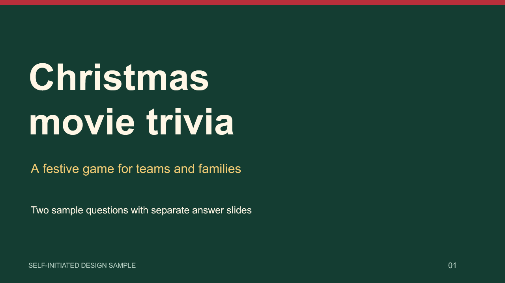
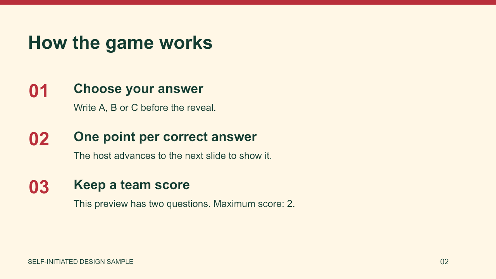
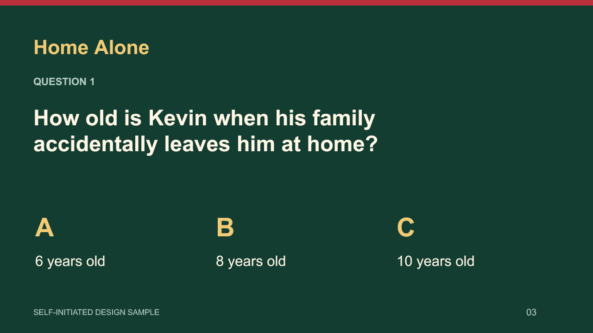
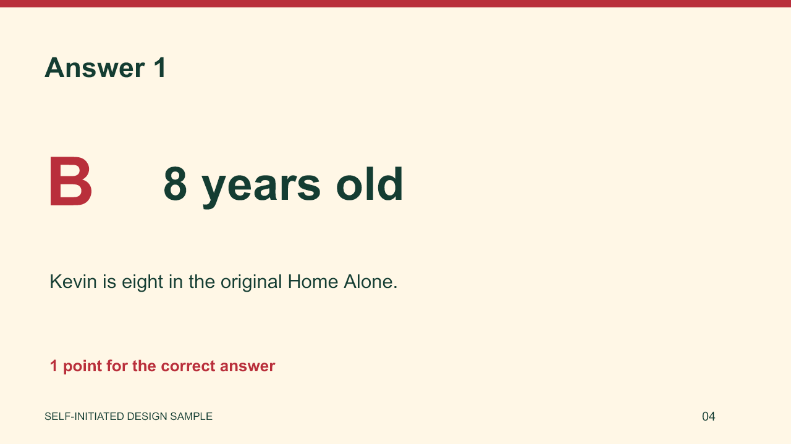
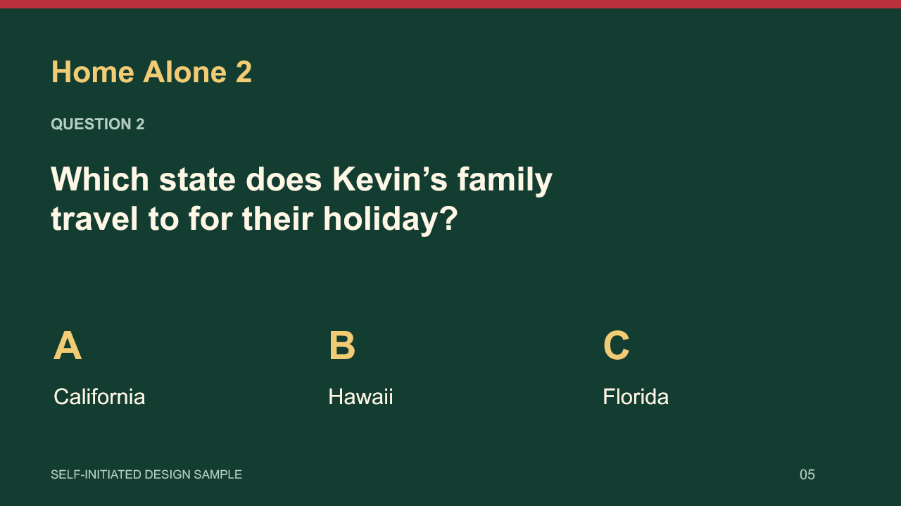
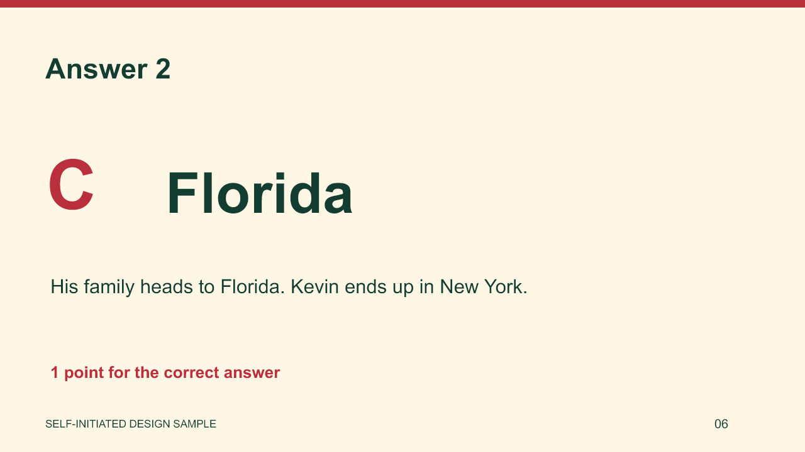

# Christmas movie trivia — design sample

An original, newly prepared six-slide demonstration for a family trivia game. It shows the visual style and question/answer flow; it is not a previous client commission or the full 36-question collection.

[Download the editable PowerPoint](christmas-movie-trivia-demo.pptx)

The slides use native editable text and original vector shapes. There are two sample questions, each followed by its answer. The full collection, question mix, delivery date, transitions and any optional audio would be agreed before production.

## Preview

## Fact-checking

The sample questions were checked against the official studio pages for [Home Alone](https://family.20thcenturystudios.com/movies/home-alone) and [Home Alone 2](https://family.20thcenturystudios.com/movies/home-alone-2). Source links are also included in the relevant slide notes.

Slide previews were rendered from a fresh import of the exported PPTX. Desktop PowerPoint playback has not been tested. This sample contains no copied film screenshots, video clips or long dialogue excerpts.
